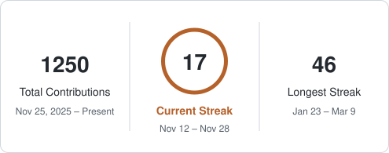
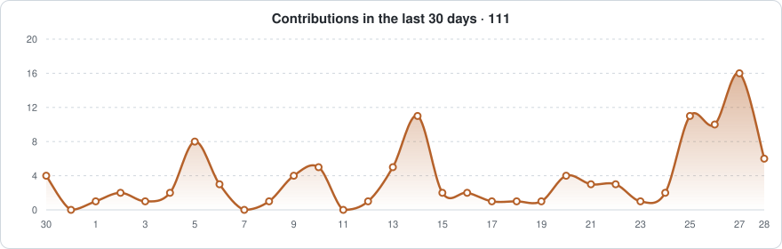

<!-- Header -->
<p align="center">
  
</p>

<p align="center">
  <a href="https://github.com/AlisherKshtykenov">
    
  </a>
</p>

<p align="center">
  
  
  
</p>

---

### 👋 About me

```python
class Alisher:
    role      = "ML student · AI-agent & automation builder"
    focus     = ["machine learning from first principles", "LLM agents", "n8n automation"]
    currently = "building a self-driving research lab: Claude Code + n8n"
    principle = "smallest working whole first, then grow it step by step"
    languages = {"code": ["Python", "Swift", "TypeScript", "Java", "Rust"], "human": ["Russian", "English"]}
```

- 🧠 I like to **write things by hand before calling the library**: logistic regression, MLPs and CNN blocks in NumPy and PyTorch, checked against sklearn and torch.
- 🤖 I build **agent systems**: labs and "factories" where Claude Code proposes hypotheses, runs experiments, commits or rolls back, and reports to Telegram.
- ⚙️ I automate workflows with **n8n**, Python and webhooks. Every workflow is tested and keeps its secrets out of git.
- 🍎 For fun, I make **tiny native macOS apps** in pure Swift, with no Xcode project: widgets, live wallpapers, and a desktop crab.

---

### 🚀 Featured projects

<table>
  <tr>
    <td width="50%" valign="top">
      <h4>🧪 <a href="https://github.com/AlisherKshtykenov/n8n-laboratory">n8n-laboratory</a></h4>
      A research lab where <b>Claude Code</b> works on any task in "hypothesis → run → commit or roll back" cycles, with <b>n8n</b> as the conveyor and a live board. First run on MNIST: val 0.91 → <b>0.98</b>, audited, reported to Telegram.
      <br><br>
      
      
      
      
    </td>
    <td width="50%" valign="top">
      <h4>‹› <a href="https://github.com/AlisherKshtykenov/code-recall">CODE RECALL</a></h4>
      LeetCode for <i>your own</i> code. You write algorithms and ML from scratch again from memory in a browser mini-IDE, graded by pytest and scheduled with <b>FSRS</b> spaced repetition. Includes a visual task builder and semantic diff.
      <br><br>
      
      
      
      
    </td>
  </tr>
  <tr>
    <td width="50%" valign="top">
      <h4>🧠 <a href="https://github.com/AlisherKshtykenov/cifar-cnn-ablation">cifar-cnn-ablation</a></h4>
      12 CNNs trained from scratch, one technique changed at a time, from a 53% MLP to a <b>92.6% ResNet-9</b> on CIFAR-10 (69.6% top-1 on CIFAR-100). Every gain is measured: BatchNorm + Dropout +7.6 pp, residuals +2.5 pp.
      <br><br>
      
      
      
    </td>
    <td width="50%" valign="top">
      <h4>🎯 <a href="https://github.com/AlisherKshtykenov/instance-segmentation-benchmark">instance-segmentation-benchmark</a></h4>
      Mask R-CNN v2 vs YOLO26-seg on COCO val2017: mask AP with pycocotools, FPS on GPU and CPU, and a speed vs accuracy map across input sizes. <b>AP 50.3 at 1.3 FPS vs AP 40.6 at 28 FPS</b>, and which one to ship where.
      <br><br>
      
      
      
    </td>
  </tr>
</table>

### 🔬 ML research

| Project | What it answers | Headline |
|---|---|---|
| 🧠 [cifar-cnn-ablation](https://github.com/AlisherKshtykenov/cifar-cnn-ablation) | What is each CNN technique actually worth? | **92.6%** CIFAR-10 · **69.6%** CIFAR-100 |
| ✨ [cifar10-image-denoising](https://github.com/AlisherKshtykenov/cifar10-image-denoising) | Autoencoders, U-Net or DnCNN: what actually removes noise, and which idea matters? | **28.45 dB** PSNR, skips worth **+2.8 dB** |
| 🎯 [instance-segmentation-benchmark](https://github.com/AlisherKshtykenov/instance-segmentation-benchmark) | Two-stage or one-stage segmentation, and when? | AP **50.3** vs **28 FPS** |
| 🌡️ [pinn-heat-equation](https://github.com/AlisherKshtykenov/pinn-heat-equation) | Forward PINN vs finite differences, and an inverse PINN that recovers an unknown coefficient | α recovered to **0.004%** |
| 🌊 [pinn-viscoacoustic-wave](https://github.com/AlisherKshtykenov/pinn-viscoacoustic-wave) | 2D wave equation in a depth-dependent medium: what does dropping the coefficient-gradient terms cost? | **2.4%** vs **7.9%** error |
| 🧩 [xpinn-material-interface](https://github.com/AlisherKshtykenov/xpinn-material-interface) | One network per rock layer, glued by displacement and stress continuity: how hard to enforce it, and do Fourier features help? | **0.29%** error, Fourier scale matters |
| 🎮 [gymnasium-rl-benchmark](https://github.com/AlisherKshtykenov/gymnasium-rl-benchmark) | Which RL algorithm solves control tasks reliably, and at what sample cost? | LunarLander **261**, own Deep CEM and REINFORCE |
| 📋 [tabular-ml-studies](https://github.com/AlisherKshtykenov/tabular-ml-studies) | RF vs SVM with error costs, an MLP in pure NumPy, PLE nets vs gradient boosting | bootstrap-tested choices |
| 🏀 [nba-elo-eda](https://github.com/AlisherKshtykenov/nba-elo-eda) | 60 years of NBA games: stratification, confounding, χ², PCA | 4-part EDA |

<details>
<summary><b>🍎 Native macOS toys</b> (pure Swift, one file each, no Xcode project)</summary>
<br>

| | Project | What it does |
|---|---|---|
| ▦ | [block-widgets](https://github.com/AlisherKshtykenov/block-widgets) | glass desktop widgets: clock, weather, Pomodoro, network, git status, **live ML-training progress** |
| ❄️ | [snow-desktop](https://github.com/AlisherKshtykenov/snow-desktop) | animated wallpaper: a snowy cabin, campfire and falling snow, paused when hidden |
| 🎞 | [live-wallpaper](https://github.com/AlisherKshtykenov/live-wallpaper) | any MP4 as a looping, battery-friendly desktop wallpaper |
| 🦀 | [clawd-pet](https://github.com/AlisherKshtykenov/clawd-pet) | the Claude Code crab walking around your desktop |

</details>

<details>
<summary><b>🌐 Full-stack</b></summary>
<br>

| Project | |
|---|---|
| [spring-react-fullstack](https://github.com/AlisherKshtykenov/spring-react-fullstack) | Spring Boot 3 REST API with JWT, Spring Data REST, OpenAPI and tests, plus six React 19 / TypeScript apps |

</details>

---

### 🛠 Tech stack

<p align="center">
  
</p>

<p align="center">
  
  
  
  
  
  
</p>

---

### 📈 Activity

<p align="center">
  <picture>
    <source media="(prefers-color-scheme: dark)" srcset="https://raw.githubusercontent.com/AlisherKshtykenov/AlisherKshtykenov/output/streak-dark.svg">
    
  </picture>
</p>

<p align="center">
  <picture>
    <source media="(prefers-color-scheme: dark)" srcset="https://raw.githubusercontent.com/AlisherKshtykenov/AlisherKshtykenov/output/heatmap-dark.svg">
    
  </picture>
</p>

<p align="center">
  <picture>
    <source media="(prefers-color-scheme: dark)" srcset="https://raw.githubusercontent.com/AlisherKshtykenov/AlisherKshtykenov/output/graph-dark.svg">
    
  </picture>
</p>


<details>
<summary>🇷🇺 <b>Коротко по-русски</b></summary>
<br>

Привет! Я Алишер, ник **КАШТАН**. Изучаю машинное обучение «с нуля», то есть сначала пишу руками и только потом беру библиотеку.
Строю агентные системы на Claude Code и n8n, автоматизирую рутину и для души делаю маленькие нативные приложения для macOS.
Главный проект сейчас — **n8n-laboratory**: лаборатория, где агент сам ставит гипотезы, проверяет их, коммитит или откатывает и присылает отчёт в Telegram.

</details>

<!-- Footer -->
<p align="center">
  
</p>
