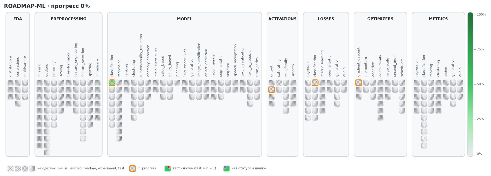

# ROADMAP-ML

Мой личный трекер пути в ML: что уже изучено, что в работе, что впереди и где сейчас проблемы.
Этот файл собирается сам из `src/` скриптом `scripts/update_progress.py` — руками не править.

<!-- progress:start -->

<!-- progress:end -->

## Прогресс

**Готовность: 0.8%** · ready 0 из 244 тем · in_progress 4 · todo 240 · закреплено повторениями: 0.1%

| Этап | Тем | ready | in_progress | todo | Готовность | Повторения |
|---|---:|---:|---:|---:|---:|---:|
| eda | 10 | 0 | 0 | 10 | 0% | 0% |
| preprocessing | 64 | 0 | 0 | 64 | 0% | 0% |
| model | 71 | 0 | 1 | 70 | 0.7% | 0.4% |
| activations | 15 | 0 | 1 | 14 | 3.3% | 0% |
| losses | 25 | 0 | 1 | 24 | 2% | 0% |
| optimizers | 24 | 0 | 1 | 23 | 2.1% | 0% |
| metrics | 35 | 0 | 0 | 35 | 0% | 0% |
| **всего** | 244 | 0 | 4 | 240 | 0.8% | 0.1% |

_Готовность — среднее `learned` (ready = 1, in_progress = 0.5, todo = 0). Повторения — `repeated` / 4, по ним красятся кубики на картинке. Динамика — в `progress_history.csv`._

## Изучено

_Пока пусто._

## В работе

| Тема | Этап / подраздел | Файл | Где применяется |
|---|---|---|---|
| logistic_regression | model / classification | [`logistic_regression.py`](src/model/classification/logistic_regression/logistic_regression.py) | — |
| sigmoid | activations / output | [`sigmoid.py`](src/activations/output/sigmoid.py) | — |
| log_loss | losses / classification | [`log_loss.py`](src/losses/classification/log_loss.py) | — |
| batch_gd | optimizers / gradient_descent | [`batch_gd.py`](src/optimizers/gradient_descent/batch_gd.py) | — |

## Планы

_Статус `todo` — ещё предстоит выучить._

<b>eda</b> — 10

- **distributions**: histogram, kde, boxplot
- **correlations**: pearson, spearman, cramers_v, mutual_information
- **multivariate**: pairplot, heatmap, pca_projection

<b>preprocessing</b> — 64

- **missing**: missing_report, missing_pattern, drop, mean_median_mode, constant, interpolation, knn_imputer, iterative_imputer, missing_indicator, ffill_bfill
- **outliers**: iqr, z_score, modified_z_score, isolation_forest, lof, dbscan, remove, clip, log_transform, impute, flag
- **encoding**: one_hot, label, ordinal, target, frequency, binary, hashing
- **scaling**: standard, minmax, robust, maxabs, normalizer
- **transformation**: log, box_cox, yeo_johnson, quantile
- **feature_engineering**: polynomial, interactions, binning, datetime_features, aggregations
- **feature_selection**: variance_threshold, correlation, chi2, mutual_information, rfe, forward_selection, backward_elimination, lasso, tree_importance
- **splitting**: holdout, stratified, kfold, stratified_kfold, group_kfold, time_series_split, leave_one_out
- **imbalance**: random_oversampling, smote, adasyn, random_undersampling, tomek_links, class_weights

<b>model</b> — 70

- **classification**: naive_bayes, decision_tree, random_forest, gradient_boosting, svm, knn
- **regression**: linear_regression, polynomial_regression, decision_tree, random_forest, gradient_boosting, svr, knn, lasso, ridge
- **ranking**: lambdamart, ranknet
- **clustering**: hierarchical, gaussian_mixture, mean_shift, dbscan, kmeans, spectral
- **dimensionality_reduction**: pca, umap, lda, autoencoder, tsne
- **anomaly_detection**: isolation_forest, one_class_svm, lof
- **association_rules**: apriori, fp_growth
- **value_based**: q_learning, sarsa, dqn
- **policy_based**: policy_gradient, ppo, actor_critic
- **planning**: mcts
- **face_recognition**: arcface, facenet
- **generative**: diffusion, gan, vae
- **image_classification**: efficientnet, resnet, vit
- **object_detection**: detr, faster_rcnn, yolo
- **recommender**: collaborative_filtering, matrix_factorization, two_tower
- **segmentation**: deeplab, mask_rcnn, unet
- **seq2seq**: encoder_decoder, transformer
- **speech_recognition**: ctc_lstm, whisper
- **text_classification**: bert, lstm
- **text_to_speech**: fastspeech, hifigan, tacotron2, vits
- **time_series**: arima, lstm, prophet

<b>activations</b> — 14

- **output**: identity, softmax, tanh
- **saturating**: sigmoid, tanh
- **relu_family**: relu, leaky_relu, prelu, elu, selu
- **smooth**: gelu, swish, mish, softplus

<b>losses</b> — 24

- **regression**: mse, mae, huber, rmse, quantile, mape
- **classification**: cross_entropy, hinge, focal, weighted_cross_entropy, gini_entropy
- **metric_learning**: pairwise, contrastive, triplet, arcface, info_nce
- **segmentation**: dice, iou
- **generative**: reconstruction, kl_divergence, adversarial, diffusion
- **audio**: ctc, mel_spectrogram

<b>optimizers</b> — 23

- **gradient_descent**: sgd, minibatch_gd
- **momentum**: momentum, nesterov
- **adaptive**: adagrad, rmsprop, adadelta
- **adam_family**: adam, adamw, nadam, adamax, amsgrad, radam
- **large_scale**: lamb, adafactor, lion
- **second_order**: newton, lbfgs
- **schedulers**: step_decay, exponential_decay, cosine_annealing, warmup, reduce_on_plateau

<b>metrics</b> — 35

- **regression**: mae, mse, rmse, r2, mape
- **classification**: accuracy, precision, recall, f1, specificity, balanced_accuracy, mcc, roc_auc, pr_auc, confusion_matrix
- **ranking**: precision_at_k, recall_at_k, map, mrr, ndcg
- **clustering**: silhouette, davies_bouldin, calinski_harabasz, ari, nmi
- **vision**: iou, dice, map_detection
- **generative**: perplexity, bleu, rouge, fid
- **audio**: wer, cer, mos

## Проблемы

_Проблем нет._
