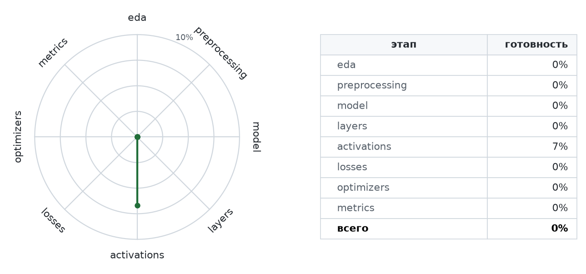

<!-- Файл собирается сам: scripts/update_progress.py. Руками не править. -->
# ROADMAP-ML

**Моя личная библиотека ML — техкарта знаний и навыков**

ML / Data Science разработчик

## Как читать карту

- Каждый квадрат — тема.
- Ярче зелёный — увереннее владею: больше свежих повторений.
- Меньше штриховки — полнее проработана: теория закрыта, конспект расписан, тест написан.
- Оранжевая рамка — в работе сейчас.

## Карта прогресса

<!-- progress:start -->

<!-- progress:end -->

## Радар навыков

_Масштаб радара подстраивается под текущий уровень — точные значения в таблице справа._

## Сейчас в работе

logistic_regression · relu · log_loss · batch_gd

## Темы

<b>EDA</b> — 10

| Подраздел | Темы |
|---|---|
| distributions | histogram, kde, boxplot |
| correlations | pearson, spearman, cramers_v, mutual_information |
| multivariate | pairplot, heatmap, pca_projection |

<b>Preprocessing</b> — 76

| Подраздел | Темы |
|---|---|
| missing | missing_report, missing_pattern, drop, mean_median_mode, constant, interpolation, knn_imputer, iterative_imputer, missing_indicator, ffill_bfill |
| outliers | iqr, z_score, modified_z_score, isolation_forest, lof, dbscan, remove, clip, log_transform, impute, flag |
| encoding | one_hot, label, ordinal, target, frequency, binary, hashing |
| scaling | standard, minmax, robust, maxabs, normalizer |
| transformation | log, box_cox, yeo_johnson, quantile |
| feature_engineering | polynomial, interactions, binning, datetime_features, aggregations |
| feature_selection | variance_threshold, correlation, chi2, mutual_information, rfe, forward_selection, backward_elimination, lasso, tree_importance |
| splitting | holdout, stratified, kfold, stratified_kfold, group_kfold, time_series_split, leave_one_out |
| imbalance | random_oversampling, smote, adasyn, random_undersampling, tomek_links, class_weights |
| augmentation | blur, cutout, flip, gaussian_noise, random_crop, rotation, color_jitter, cutmix, mixup |
| images | loading, normalization, resize |

<b>Model</b> — 72

| Подраздел | Темы |
|---|---|
| classification | logistic_regression, naive_bayes, decision_tree, random_forest, gradient_boosting, svm, knn |
| regression | linear_regression, polynomial_regression, decision_tree, random_forest, gradient_boosting, svr, knn, lasso, ridge |
| ranking | lambdamart, ranknet |
| clustering | hierarchical, gaussian_mixture, mean_shift, dbscan, kmeans, spectral |
| dimensionality_reduction | pca, umap, lda, autoencoder, tsne |
| anomaly_detection | isolation_forest, one_class_svm, lof |
| association_rules | apriori, fp_growth |
| value_based | q_learning, sarsa, dqn |
| policy_based | policy_gradient, ppo, actor_critic |
| planning | mcts |
| face_recognition | arcface, facenet |
| generative | diffusion, gan, vae |
| image_classification | efficientnet, resnet, vit, simple_cnn |
| object_detection | detr, faster_rcnn, yolo |
| recommender | collaborative_filtering, matrix_factorization, two_tower |
| segmentation | deeplab, mask_rcnn, unet |
| seq2seq | encoder_decoder, transformer |
| speech_recognition | ctc_lstm, whisper |
| text_classification | bert, lstm |
| text_to_speech | fastspeech, hifigan, tacotron2, vits |
| time_series | arima, lstm, prophet |

<b>Layers</b> — 27

| Подраздел | Темы |
|---|---|
| attention | cross_attention, multi_head_attention, positional_encoding, self_attention |
| connections | dense_connection, residual, skip_concat |
| convolutional | conv1d, conv2d, depthwise_separable, dilated, transposed_conv |
| core | dense, flatten |
| embedding | embedding |
| normalization | batch_norm, group_norm, instance_norm, layer_norm |
| pooling | avg_pool, global_avg_pool, max_pool |
| recurrent | gru, lstm, rnn |
| regularization | dropout, spatial_dropout |

<b>Activations</b> — 15

| Подраздел | Темы |
|---|---|
| output | identity, sigmoid, softmax, tanh |
| saturating | sigmoid, tanh |
| relu_family | relu, leaky_relu, prelu, elu, selu |
| smooth | gelu, swish, mish, softplus |

<b>Losses</b> — 25

| Подраздел | Темы |
|---|---|
| regression | mse, mae, huber, rmse, quantile, mape |
| classification | log_loss, cross_entropy, hinge, focal, weighted_cross_entropy, gini_entropy |
| metric_learning | pairwise, contrastive, triplet, arcface, info_nce |
| segmentation | dice, iou |
| generative | reconstruction, kl_divergence, adversarial, diffusion |
| audio | ctc, mel_spectrogram |

<b>Optimizers</b> — 25

| Подраздел | Темы |
|---|---|
| gradient_descent | batch_gd, sgd, minibatch_gd |
| momentum | momentum, nesterov |
| adaptive | adagrad, rmsprop, adadelta |
| adam_family | adam, adamw, nadam, adamax, amsgrad, radam |
| large_scale | lamb, adafactor, lion |
| second_order | newton, lbfgs |
| schedulers | step_decay, exponential_decay, cosine_annealing, warmup, reduce_on_plateau, early_stopping |

<b>Metrics</b> — 35

| Подраздел | Темы |
|---|---|
| regression | mae, mse, rmse, r2, mape |
| classification | accuracy, precision, recall, f1, specificity, balanced_accuracy, mcc, roc_auc, pr_auc, confusion_matrix |
| ranking | precision_at_k, recall_at_k, map, mrr, ndcg |
| clustering | silhouette, davies_bouldin, calinski_harabasz, ari, nmi |
| vision | iou, dice, map_detection |
| generative | perplexity, bleu, rouge, fid |
| audio | wer, cer, mos |

